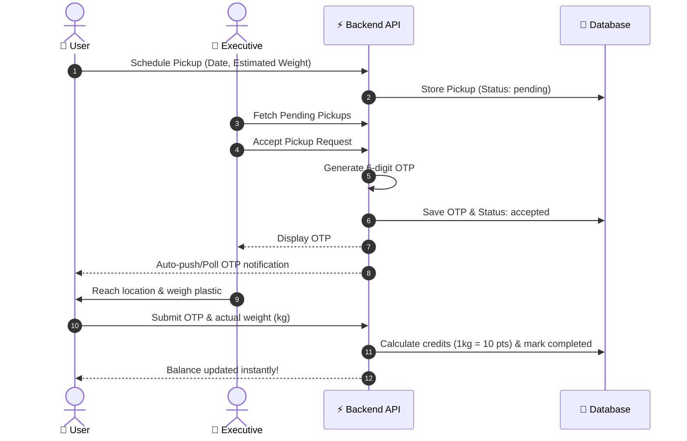

# 🌿 Eco Sorter – Next-Generation Plastic Waste Management Platform

[](https://kit.svelte.dev/)
[](https://tailwindcss.com/)
[](https://greensock.com/gsap/)
[](https://nodejs.org/)
[](https://expressjs.com/)
[](https://eco-sorter.netlify.app)
[](https://eco-sorter-backend.onrender.com/api)

> **Eco Sorter** connects citizens, collection executives, and recycling facilities in an integrated, transparent ecosystem. Transform recycled plastic waste into redeemable rewards through scheduled pickups, real-time tracking, and verified OTP-based transactions.

---

## 🌐 Live Deployments & Links

| Service | URL / Repository |
| :--- | :--- |
| **Frontend Web App** | [https://eco-sorter.netlify.app](https://eco-sorter.netlify.app) |
| **Backend API Service** | [https://eco-sorter-backend.onrender.com/api](https://eco-sorter-backend.onrender.com/api) |
| **Frontend Repository** | [github.com/Aayushsharma490/eco-sorter](https://github.com/Aayushsharma490/eco-sorter) |
| **Backend Repository** | [github.com/Aayushsharma490/Eco--sorter-backend](https://github.com/Aayushsharma490/Eco--sorter-backend) |

---

## 🔐 Demo Login Credentials

You can test all roles directly on the platform:

| Role | Email | Password | Primary Capabilities |
| :--- | :--- | :--- | :--- |
| **👤 User** | `user@demo.com` | `demo123` | Schedule pickups, monitor dustbin fill %, view credits balance & unlock reward tiers. |
| **🚚 Pickup Executive** | `executive@demo.com` | `demo123` | View pending pickups in area, accept pickups, generate verification OTPs, log GPS coordinates. |
| **🛡️ Admin** | `admin@demo.com` | `demo123` | Full dashboard analytics, user management (CRUD), critical dustbin monitoring, center oversight. |

---

## ✨ Key Features

### 1. 👤 User Dashboard (`/dashboard/user`)
- **Real-Time Smart Dustbin Monitor**: Live tracking of bin fill percentage with visual warning states (Low `<50%`, Moderate `50-79%`, Critical `80-100%`).
- **Pickup Scheduling**: Request doorstep plastic collection with preferred time slot and estimated weight.
- **Credit Balance & History**: Instant credit allocation upon pickup verification (1 kg plastic = 10 credits).
- **Secure Pickup Handover**: Automated OTP confirmation to guarantee accurate weighed collection.

### 2. 🚚 Pickup Executive Dashboard (`/dashboard/executive`)
- **Queue Management**: Real-time list of pending pickup requests sorted by proximity and schedule.
- **Instant OTP Generation**: Executive accepts pickup, system issues secure 6-digit verification code.
- **Weighed Verification**: Executive records verified weight upon collection; system calculates credits dynamically.
- **Geolocation Updates**: Coordinates logged for live route tracking.

### 3. 🛡️ Admin Management Suite (`/dashboard/admin`)
- **System KPIs**: Real-time aggregates of total registered users, active executives, collection centers, and total plastic diverted from landfills (kg).
- **User Management (CRUD)**: Create, view, update, and remove platform accounts with role assignments.
- **Critical Dustbin Alerts**: Flagging overloaded dustbins for immediate dispatch.
- **Collection Centers Directory**: Manage partner recycling hubs, contact information, and serviceable pincodes.

### 4. 🎁 Tiered Benefits & Rewards System (`/benefits`)
Incentivizing recycling through multi-tier reward levels:
- 🥉 **Bronze (500 pts)**: Food delivery discounts (Swiggy, Zomato), mobile recharges, movie tickets.
- 🥈 **Silver (1,000 pts)**: Grocery vouchers (Blinkit, Zepto, BigBasket), fuel discounts.
- 🥇 **Gold (2,000 pts)**: Premium movie seats, dining perks, shopping vouchers (Amazon, Flipkart).
- 💎 **Platinum (5,000 pts)**: Free monthly movie passes, luxury hotel discounts, travel credits.
- 💠 **Diamond (10,000 pts)**: VIP membership, 5-star hotel vouchers, international flight perks, eco-gifts.

---

## 🔄 End-to-End Pickup & OTP Flow



---

## 🛠️ Tech Stack & Architecture

### **Frontend**
- **Framework**: [SvelteKit](https://kit.svelte.dev/) (with Vite)
- **Styling**: [Tailwind CSS](https://tailwindcss.com/) & Glassmorphic UI design
- **Animations**: [GSAP (GreenSock)](https://greensock.com/gsap/) with ScrollTrigger
- **Typography**: DM Sans Variable
- **Hosting**: Netlify

### **Backend**
- **Runtime**: [Node.js](https://nodejs.org/) & [Express.js](https://expressjs.com/)
- **Authentication**: JSON Web Tokens (JWT) & bcrypt password hashing
- **Data Layer**: Dual support for MongoDB (Mongoose) & lightweight JSON database store (`db.json`)
- **Hosting**: Render

---

## 🚀 Getting Started Locally

### Prerequisites
- Node.js (v18 or higher)
- npm or pnpm or yarn
- Git

### 1. Clone the Repository
```bash
git clone https://github.com/Aayushsharma490/eco-sorter.git
cd eco-sorter
```

### 2. Frontend Setup
```bash
# Install frontend dependencies
npm install

# Setup environment file
cp .env.example .env
```

Ensure `.env` contains:
```env
# For local development with local backend:
# VITE_API_URL=http://localhost:5000/api

# For production backend:
VITE_API_URL=https://eco-sorter-backend.onrender.com/api
```

Start the frontend development server:
```bash
npm run dev
```
Open your browser at `http://localhost:5173`.

### 3. Backend Setup
```bash
# Navigate to backend folder
cd backend

# Install backend dependencies
npm install

# Start backend server
node server.js
```
The backend will run on `http://localhost:5000`.

---

## 📡 API Overview

| Method | Endpoint | Description | Protected Role |
| :--- | :--- | :--- | :--- |
| `POST` | `/api/auth/login` | Authenticate user & issue JWT | Public |
| `GET` | `/api/auth/me` | Fetch currently authenticated user | Any authenticated |
| `GET` | `/api/stats/user` | Fetch user dashboard metrics & credits | User |
| `GET` | `/api/stats/executive` | Fetch executive stats & route overview | Executive |
| `GET` | `/api/stats/admin` | Fetch system-wide platform statistics | Admin |
| `GET` | `/api/pickups/pending` | List pending pickups available | Executive |
| `POST` | `/api/pickups` | Schedule a new plastic pickup | User |
| `PUT` | `/api/pickups/:id/accept` | Accept pickup and generate OTP | Executive |
| `PUT` | `/api/pickups/:id/verify-otp` | Verify OTP and credit points | User / Exec |
| `GET` | `/api/centers` | Fetch list of collection centers | Public |
| `GET` | `/api/users` | List all users (admin) | Admin |
| `POST` | `/api/users` | Create user (admin) | Admin |
| `DELETE`| `/api/users/:id` | Delete user (admin) | Admin |

---

## 📂 Repository Structure

```
eco-sorter/
├── src/
│   ├── lib/
│   │   ├── components/      # Reusable UI components (Header, Footer, Modals)
│   │   ├── slices/          # Feature slices (Hero, Journey, Rewards, FAQ)
│   │   └── api.js           # Centralized API service client
│   └── routes/
│       ├── +page.svelte     # Initial landing route
│       ├── landing/         # Welcome & introduction splash
│       ├── home/            # Main interactive landing page
│       ├── login/           # Role-based login portal
│       ├── benefits/        # 5-Tier reward program
│       ├── centers/         # Collection centers directory
│       └── dashboard/
│           ├── user/        # Citizen dashboard
│           ├── executive/   # Pickup executive dashboard
│           └── admin/       # Management & analytics suite
├── backend/                 # Backend API service
│   ├── routes/              # Express route handlers
│   ├── models/              # Mongoose / JSON data models
│   ├── middleware/          # JWT auth & role guards
│   ├── data/db.json         # Local data store fallback
│   ├── seed.js              # Database seeder script
│   └── server.js            # Express server entry point
├── static/                  # Static assets & icons
├── .env.example             # Frontend environment variables template
└── README.md                # Project documentation
```

---

## 📱 Mobile App

Complementary mobile experience available:
- [Eco Sorter Android App on Google Play](https://play.google.com/store/apps/details?id=com.ecocredit)

---

## 🤝 Contributing

Contributions make the open-source community an incredible place to learn, inspire, and create:
1. Fork the Project
2. Create your Feature Branch (`git checkout -b feature/AmazingFeature`)
3. Commit your Changes (`git commit -m 'Add some AmazingFeature'`)
4. Push to the Branch (`git push origin feature/AmazingFeature`)
5. Open a Pull Request

---

## 📄 License & Attribution

Distributed under the MIT License. See `LICENSE` for more information.

Developed with 💚 for a cleaner, sustainable planet.
